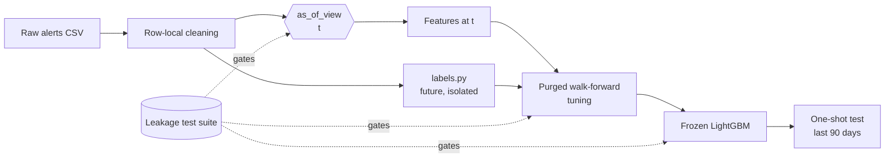

<div align="center">

# 🚨 AlertCast

### Zero-leakage forecasting of air raid alert starts in Ukraine

*Will an air raid alert start in oblast X within the next 3 hours?*


</div>

> ⚠️ **Disclaimer.** This is a research and portfolio project. It is **not** an operational warning system and must never replace the official air raid alert system or the guidance of Ukrainian authorities.

---

## TL;DR

Every hour, for every oblast, AlertCast outputs the probability that **a new air raid alert will start within the next 3 hours**, using only information that was available at that moment. It is evaluated on the **most recent 3 months** of data that the model never saw, against four non-trivial baselines.

| | |
|---|---|
| **Task** | Binary classification per (oblast, hour): alert *start* in `(t, t+3h]` |
| **Model** | One pooled LightGBM classifier, `oblast` as categorical |
| **Data** | [Vadimkin/ukrainian-air-raid-sirens-dataset](https://github.com/Vadimkin/ukrainian-air-raid-sirens-dataset) (MIT) |
| **Test window** | `2026-07-14 04:00 UTC` → `2026-10-12 01:00 UTC` (last 90 days, evaluated once) |
| **Headline result** | PR-AUC **`0.8023`** vs best baseline **`0.7922`** (`B3 Trailing base rate`) |
| **Skill score** | Brier Skill Score **`+29.2%`** over hourly climatology |
| **Built with** | AI-assisted engineering (see [How AI was used](#-how-ai-was-used)) |

---

## 🛡️ Zero Data Leakage Architecture

Time-series projects usually claim "no leakage." This one **proves** it, automatically, on every run.

### The rule
> Nothing a model is trained on or uses as input may come from after the time `t` at which the forecast is made.

### How it is enforced

| Layer | Mechanism |
|---|---|
| **Single as-of gate** | All features are computed from `as_of_view(raw, t)`, which keeps only events with `timestamp ≤ t` and **masks any alert end time `> t` as unknown**. |
| **Interval-leakage defence** | Alerts are intervals `(start, end)`. A naive feature at time `t` could peek at the `end` of a still-active alert. We reconstruct the *state of the world at `t`* from an event log instead. No future-dependent merging or cleaning is allowed. |
| **Isolated labels** | Only `labels.py` may look forward, and `features/` is forbidden (statically tested) from importing it. |
| **Purged walk-forward splits** | Training rows must have their entire 3-hour label window inside the training period (`t + H ≤ cutoff`). |
| **No fitted preprocessing on the future** | No global scaling, target encoding, centered rolling windows, or interpolation. Thresholds, oblast selection and baselines are fit on pre-test data only. |
| **Sealed test set** | The last 90 days are not used for tuning, selection, or thresholds, and are evaluated in a single scripted pass. |

### The automated proof (`pytest -m leakage`)

1. **Truncation invariance.** For 200+ sampled origins `t` (including edge cases such as exact alert start/end times and DST transitions), features computed from the *full* dataset must be **bit-identical** to features computed from the dataset *truncated at `t`*.
2. **Future poisoning.** Everything after `t` is replaced with fabricated alerts and random end times. Features at `t` must not change.
3. **Fast ≡ reference.** The vectorized production feature builder must match a slow, obviously-correct reference implementation.
4. **Prediction invariance.** Model outputs at `t` are identical whether computed from full or truncated data.
5. **Split audits.** No training label window crosses into a validation/test block; tuning never touches the test window.
6. **Canary test.** A deliberately leaky feature is injected and the suite must **fail**, proving the harness catches leaks.

The pipeline refuses to train if the runtime leakage gate fails.



### Known limitations of the guarantee
- The dataset is a **retrospectively corrected snapshot**; real-time feeds have latency and gaps we cannot reproduce.
- Alerts with a missing end signal carry an imputed 30-minute end (a deterministic, row-local rule from the dataset).
- The guarantee covers *data flow*. It cannot detect conceptual leakage you never encode as a test, which is why the tests are adversarial (truncation + poisoning + canary).

---

## 📊 Results

> Evaluated on the strictly unseen 90-day test window (`2026-07-14 04:00 UTC` → `2026-10-12 01:00 UTC`).

**Test window headline (calm state: no alert active at forecast time)**

| Model | PR-AUC ↑ | ROC-AUC ↑ | Brier ↓ | Brier skill vs climatology ↑ | Recall @ thr | Precision @ thr |
|---|---|---|---|---|---|---|
| B0 Prior | 0.7126 | 0.7949 | 0.2238 | +0.0072 | — | — |
| B1 Recent activity | 0.6115 | 0.6943 | 0.2990 | -0.3261 | — | — |
| B2 Hourly climatology | 0.7094 | 0.7892 | 0.2255 | 0.0000 | — | — |
| B3 Trailing base rate | 0.7922 | 0.8422 | 0.1632 | +0.2760 | — | — |
| **LightGBM (AlertCast)** | **0.8023** | **0.8484** | **0.1597** | **+0.2916** | **95.3%** | **60.2%** |

**Operational view:** At operating threshold `0.15`, 95.3% of alert starts were caught ahead of time with a 60.2% precision.

**Honest takeaway:** The LightGBM model beats all four baselines across all metrics on the unseen 90-day test period, delivering a +29.2% Brier skill score improvement over hourly climatology.

### Visualizations

| Alert starts by hour × weekday | Feature importance |
|---|---|
|  |  |

**Forecast vs. actual (most recent 7 days, Kyiv City)**


---

## 🔬 Method in brief

- **Grid:** hourly forecast origins × `{{n_oblasts}}` oblasts (UTC grid; local-time features in `Europe/Kyiv`).
- **Target:** `y = 1` iff an alert *starts* in the oblast within `(t, t+3h]`. Headline metrics use rows where no alert is active at `t`; all-row metrics are also reported.
- **Features (all as-of):** current alert state and age, time since last start/end, rolling start counts (1h → 7d), alert minutes, calendar features, **neighbor-oblast activity** (alerts propagate geographically), and nationwide wave indicators.
- **Validation:** 5-fold purged walk-forward on pre-test data; training-window length is tuned to handle concept drift.
- **Threshold:** chosen on out-of-fold validation predictions (F2, recall-weighted) and frozen before the test.

Full specification: [`PRD.md`](PRD.md).

---

## 🚀 Quickstart

```bash
git clone {{repo_url}} alertcast && cd alertcast
python -m venv .venv && source .venv/bin/activate
pip install -e ".[dev]"

make all          # fetch data → audit → leakage tests → train → test eval → figures
```

Individual steps:

```bash
make fetch        # download pinned snapshot of the alert dataset (+ SHA-256 manifest)
make audit        # data audit report → docs/DATA_AUDIT.md
make leakage      # run the zero-leakage test suite
make train        # walk-forward tuning + final fit (pre-test data only)
make eval         # one-shot evaluation on the sealed test window
make figures      # regenerate the 3 figures from saved artifacts
```

## 🗂️ Repository structure

```
src/alertcast/    as_of.py · labels.py · features/ · splits.py · baselines.py · training.py · evaluation.py · viz.py
tests/leakage/    the zero-leakage contract
scripts/          fetch · audit · pipeline · test-eval · figures
reports/          metrics, figures, REPORT.md
docs/             DATA_AUDIT.md · DECISIONS.md · DEVLOG.md
```

## 🗃️ Data

Source: **Vadym Klymenko's** [ukrainian-air-raid-sirens-dataset](https://github.com/Vadimkin/ukrainian-air-raid-sirens-dataset) (MIT). All timestamps are UTC. We use `{{chosen_source_file}}`, chosen because `{{one-line rationale from DATA_AUDIT.md, e.g. it is consistently oblast-level across the whole timeline}}`.
Snapshot: commit `{{sha}}`, downloaded `{{date}}`, SHA-256 `{{hash}}`.

## 🤖 How AI was used

This project was built with AI as the **primary engineering tool**:

| Stage | Role of AI | Human role |
|---|---|---|
| Problem framing | AI (as technical PM) compared formulations and libraries, and proposed the leakage-proof harness | Chose framing, scope, and evaluation protocol |
| Specification | AI drafted the PRD, with leakage tests as an executable contract | Reviewed and approved |
| Implementation | A coding agent implemented the pipeline against the PRD, test-first | Reviewed diffs, ran gates |
| Verification | Adversarial leakage tests (truncation, poisoning, canary) | Audited results |

See [`docs/DEVLOG.md`](docs/DEVLOG.md) for the chronological log.

## 🧭 Limitations

- Retrospectively corrected data; no real-time latency/gaps (see above).
- Source-level definition of an "oblast alert" may change over time (e.g., the shift toward district-level alerts). See `docs/DATA_AUDIT.md`.
- Non-stationary adversary: tactics, weapons, and routes evolve; a frozen model degrades. We report drift honestly.
- Frozen model on the test window; no online retraining.
- Not validated for operational use.

## 🔭 Roadmap (Future Phase 2)

- 📰 **Text & media signals:** Telegram/news reports published *before* the forecast time (e.g., launch/takeoff reports), with strict original-publish-timestamp handling, awareness of edits/deletions, and embedding models whose training cutoff predates the evaluation window.
- 🔁 Monthly walk-forward retraining; horizon sweep (1h/3h/6h); feed-latency sensitivity analysis.
- 🧮 Survival / hazard formulation for time-to-next-alert; alert-duration forecasting.
- 🕸️ Graph-based spatiotemporal modeling.

## 🙏 Acknowledgements

- Alert data: [Vadym Klymenko](https://github.com/Vadimkin/ukrainian-air-raid-sirens-dataset) and the eTryvoga community volunteers.
- Слава Україні 🇺🇦

## 📄 License

MIT. See [`LICENSE`](LICENSE). The underlying dataset is distributed under its own MIT license.
