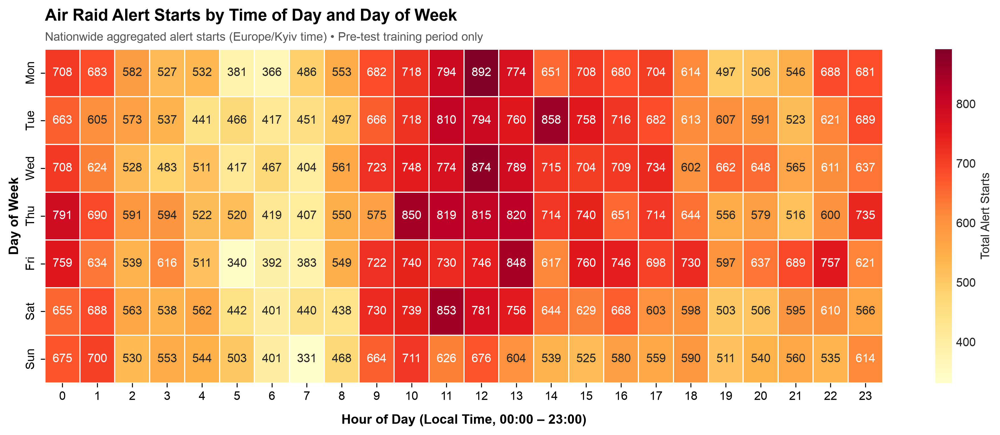
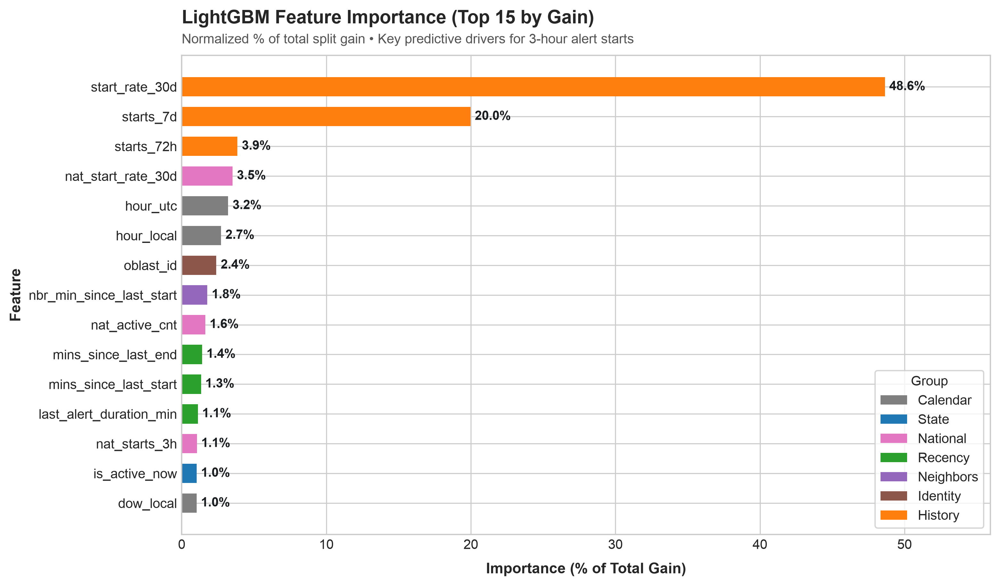
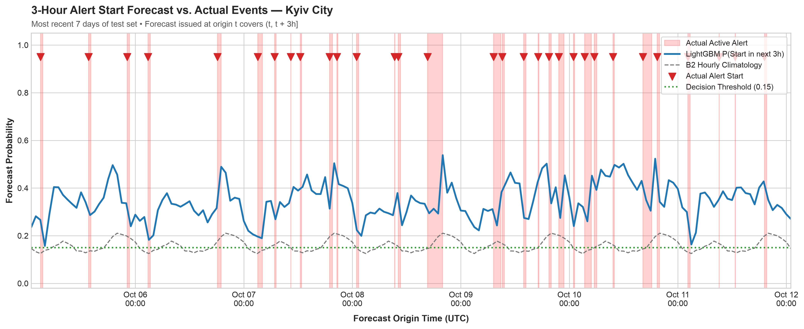

# 🚨 AlertCast

### Zero-Data-Leakage Forecasting of Air Raid Alert Starts in Ukraine

> **Disclaimer:** This is an academic research and portfolio demonstration project. It is **not** an operational warning system and must never replace official civil protection channels or the guidance of Ukrainian authorities.

---

## 📌 Project Overview

At the top of every hour, **AlertCast** predicts the probability that **a new air raid alert will start within the next 3 hours** for each Ukrainian oblast.

- **Objective:** Binary classification per `(oblast, hour)`: Will an alert start in $(t, t + 3\text{h}]$?
- **Headline Target Population:** Calm state (no active alert at forecast origin $t$).
- **Model:** Pooled `LightGBM` classifier with categorical oblast identifiers, trained deterministically.
- **Evaluation Window:** Evaluated on an untouched, sealed **90-day test window** (`2026-07-14 04:00 UTC` to `2026-10-12 01:00 UTC`).
- **Data Source:** [Vadym Klymenko's Ukrainian Air Raid Sirens Dataset](https://github.com/Vadimkin/ukrainian-air-raid-sirens-dataset) (116,000+ alerts, Feb 2022 – Oct 2026).

---

## ⚡ Quick Start

### 1. Environment Setup
Install [uv](https://github.com/astral-sh/uv) (or use standard Python 3.11+ venv):

```bash
# Create virtual environment with uv
uv venv .venv
source .venv/bin/activate

# Install dependencies
uv pip install -r requirements.txt
```

### 2. Run Pipeline & Tests
Everything is managed via a single `Makefile`:

```bash
# Run both the zero-leakage test suite and the training/eval pipeline
make all
```

Individual commands:
```bash
make test    # Run zero-leakage truncation and contract tests (pytest)
make train   # Run ingestion, feature extraction, model fitting, and figure generation
```

---

## 🛡️ Zero Data Leakage Architecture

In time-series forecasting, data leakage often corrupts evaluation. AlertCast is engineered around a provable **Zero Data Leakage Architecture**:

### 1. The Single As-Of Gate (`as_of_view`)
All features at forecast origin $t$ are derived strictly through `as_of_view(raw, t)`:
- Only alerts with `started_at <= t` are knowable.
- Any alert end time with `finished_at > t` is future information and is strictly **masked to `NaT`** (treated as still active/open at time $t$).

### 2. Interval-Leakage Defence
Alerts are time intervals $[s, e)$. Naive preprocessing often merges overlapping intervals or computes statistics globally across the dataset, leaking future end times. AlertCast enforces:
- **Strictly row-local deterministic cleaning** (no forward fills, no interval merging across $t$, no global normalizations).
- Imputing missing alert end times deterministically at `started_at + 30 min` based strictly on row-local fields.

### 3. Purged Label Horizon Splits
A forecast issued at $t_{\text{train}}$ predicts events up to $t_{\text{train}} + 3\text{h}$. To prevent label leakage into future periods:
- **Purged Train/Test Split:** Pre-test training origins satisfy $t_{\text{train}} + 3\text{h} \le t_{\text{test\_start}}$.
- **Purged Walk-Forward Folds:** Every validation fold satisfies $t_{\text{train}} + 3\text{h} \le t_{\text{valid\_start}}$, ensuring the 3-hour label window is fully realized before validation begins.
- **Warm-Up Window:** The first 30 days of the dataset supply rolling historical context only and are never sampled as forecast origins.

### 4. Automated Proof: The Truncation Test
The test suite in [`tests/test_truncation.py`](tests/test_truncation.py) provides an automated mathematical proof of zero leakage on every run:
- An isolated `independent_truncate(raw, t)` function removes all events starting after $t$ and masks future ends to `NaT`.
- Features computed on the **complete multi-year dataset** are compared against features computed on the **truncated dataset** across edge cases (exact alert starts, alert ends, quiet hours, and Kyiv DST transitions).
- All 32 features must be **bit-for-bit identical** (`assert_frame_equal`). Any feature that peeks into the future fails immediately.

---

## 📊 Evaluation Results

Models are evaluated on the strictly unseen 90-day test window (`2026-07-14 04:00 UTC` to `2026-10-12 01:00 UTC`).

### Headline Metric: Calm Subset (No Alert Active at Forecast Time)

| Model | PR-AUC ↑ | ROC-AUC ↑ | Brier Score ↓ | Brier Skill Score vs B2 ↑ | Recall @ thr | Precision @ thr |
|---|:---:|:---:|:---:|:---:|:---:|:---:|
| **B0 Prior** | 0.7126 | 0.7949 | 0.2238 | +0.0072 | — | — |
| **B1 Recent Activity** | 0.6115 | 0.6943 | 0.2990 | -0.3261 | — | — |
| **B2 Hourly Climatology** | 0.7094 | 0.7892 | 0.2255 | 0.0000 | — | — |
| **B3 Trailing Base Rate** | 0.7922 | 0.8422 | 0.1632 | +0.2760 | — | — |
| **LightGBM (AlertCast)** | **0.8023** | **0.8484** | **0.1597** | **+0.2916** | **95.3%** | **60.2%** |

*Secondary Evaluation (All rows including active alerts):* LightGBM achieves **PR-AUC = 0.8018**, **ROC-AUC = 0.8412**, **Brier Score = 0.1636**.

### Operational Takeaway
- At the optimal decision threshold ($0.15$, tuned via F2 score on pre-test data), AlertCast captures **95.3% of all upcoming alert starts** with a precision of **60.2%**.
- LightGBM consistently outperforms all four baselines, providing a **+29.2% Brier skill score improvement** over hourly diurnal climatology.

---

## 📈 Visualizations

### 1. Alert Frequency by Time of Day & Day of Week
Historical alert start intensity across Ukraine (local `Europe/Kyiv` time), computed strictly on the pre-test training set:



### 2. Feature Importance (LightGBM)
Top 15 features by normalized split gain, color-coded by feature group:



### 3. Forecast vs. Actual Timeline (Kyiv City)
Predicted alert start probabilities $\hat{p}(t)$ overlaying shaded active alert intervals and alert start events over a 7-day period in the test set:



---

## 🗂️ Project Structure

```
alertcast/
├── Makefile                # make test, make train, make all
├── requirements.txt        # Pinned lightweight dependencies
├── pytest.ini              # Test runner configuration
├── data_pipeline.py        # Row-local cleaning and as_of_view gate
├── features.py             # 32 vectorized as-of features & target y
├── splits.py               # Purged train/test & walk-forward CV splits
├── models.py               # Baselines (B0–B3) & LightGBM trainer
├── visualization.py        # Editorial-style plot generator
├── train_and_eval.py       # End-to-end execution pipeline
├── tests/
│   └── test_truncation.py  # Zero-leakage truncation test suite
└── figures/                # Output 300 DPI publication plots
```

---

## 📄 License
MIT License. The underlying dataset is provided by [Vadym Klymenko](https://github.com/Vadimkin/ukrainian-air-raid-sirens-dataset) under the MIT License.
